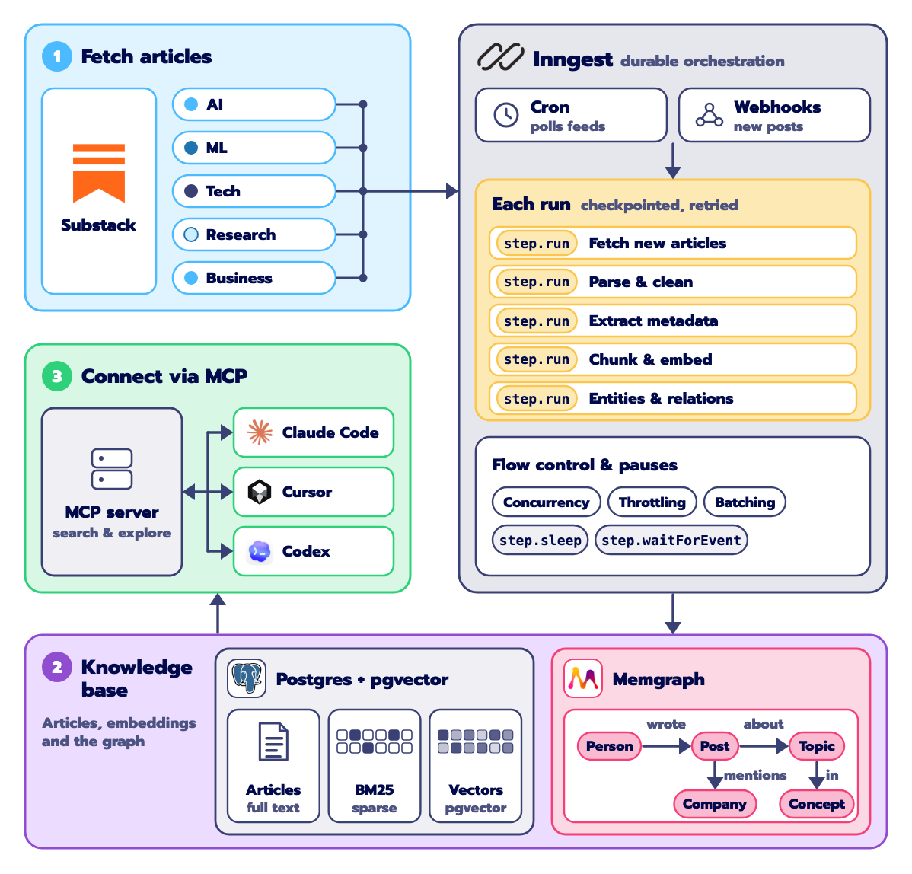

<div align="center">
  <h1>The Second Brain</h1>
  <h3>Build a second brain from newsletters, articles and other sources, one your AI tools can search, cite and reason over</h3>
</div>

</br>

<p align="center">
    <a href="static/overview.png"></a>
</p>

## Table of Contents

- [Table of Contents](#table-of-contents)
- [Overview](#overview)
- [Getting Started](#getting-started)
- [Working with the project](#working-with-the-project)

## Overview

**The Second Brain**, a knowledge base that turns technical newsletters into something your AI tools can query. It reads the articles, keeps itself fresh, understands who said what, and answers with citations. All of it runs on [Inngest](https://www.inngest.com/long-run), the durable orchestration engine that makes it survive real-world failures.

By the end of this course, you'll have a system capable of:

- Ingesting newsletters straight from their RSS feeds, safely, from an allowlist
- Running every pipeline as **durable [Inngest](https://www.inngest.com/long-run) steps** that survive crashes, retries and rate limits
- Searching with **hybrid retrieval**: BM25 and dense vectors fused into one ranking, inside Postgres
- Answering questions with **citations** you can click and verify
- Staying fresh with a poller that costs almost nothing when nothing has changed
- Extracting who said what into a **Memgraph** knowledge graph
- Plugging into **Claude Code, Cursor and Codex** through an MCP server
- Measuring quality with **evals built from your own failures**, not vibes
- Running a bounded research agent and a weekly digest, deployed for real

---

## Getting Started

Before diving in, make sure you have:

1. 🐳 [Docker](https://docs.docker.com/get-docker/) running
2. 📦 [uv](https://docs.astral.sh/uv/) installed
3. 🔑 An [OpenAI API key](https://platform.openai.com/api-keys) with a little credit (used for embeddings;
4. 🔑 _(optional)_ An [Anthropic API key](https://console.anthropic.com/) for the answers written by `POST /ask` and `kb_ask`. Without it, they return the retrieved passages only.

---

## Working with the project

### Tools for looking inside

| Tool                   | URL                   | For                                                                                                                |
| ---------------------- | --------------------- | ------------------------------------------------------------------------------------------------------------------ |
| **Adminer**            | `localhost:8081`      | Browse Postgres and watch rows land in `articles`, `passages`, and `claims`.                                       |
| **Inngest dev server** | `localhost:8288`      | Every function, run and step, with its timeline and retries.                                                       |
| **Memgraph Lab**       | `localhost:3000`      | Visual graph explorer for Cypher queries over `:Publication`, `:Author`, `:Article`, `:Claim`, and `:Topic` nodes. |
| **Swagger UI**         | `localhost:8000/docs` | Try every endpoint from the browser.                                                                               |

### Useful commands

```bash
make check     # lint (ruff + mypy) and tests
make stop      # docker compose down (your data is kept)
make db-clear  # destructive: empties every table and Memgraph, keeps the schema
make reset     # destructive: docker compose down -v, drops all data
make nuke      # destructive: reset, plus kills a stray app process on the port
```

### Repository layout

- `kb/`: the pipeline (`functions/` for Inngest, `agents/` for hand-written agent steps, `graph/` for Memgraph ontology & Cypher, `evals/` for deterministic checks, binary LLM judges & TPR/TNR calibration, `sources/` for fetch/parse/chunk/embed/quote-validation, `db/`, `retrieval/`, `schemas/`, `mcp/` for the MCP server)
- `evals/`: failure taxonomy (`taxonomy.yaml`), human-labeled traces (`labeled_traces.jsonl`), and the retrieval variant benchmark (`golden_benchmark.yaml`)
- `publications.yaml`: the allowlist of feeds the pipeline may ingest
- `alembic/`: database migrations
- `infra/docker-compose.yml`: Postgres (pgvector), Adminer, Inngest dev server, Memgraph, Memgraph Lab
- `scripts/replay_backfill.py` & `scripts/calibrate_judges.py`: replay verifier and TPR/TNR binary judge calibration CLI
- `tests/`: the unit tests, which need no Docker or API keys
- `tests/integration/`: tests that need the stack from `make start` running (they are skipped otherwise)

---
